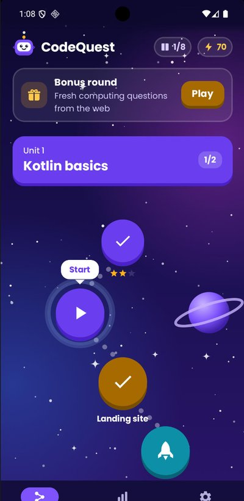
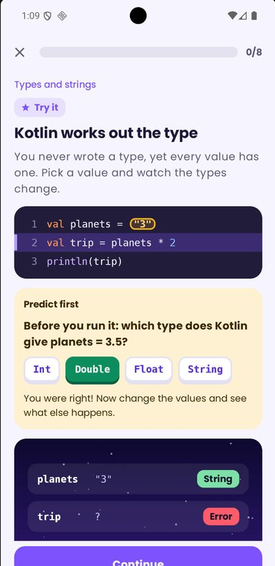
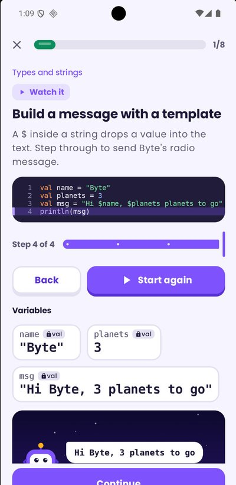
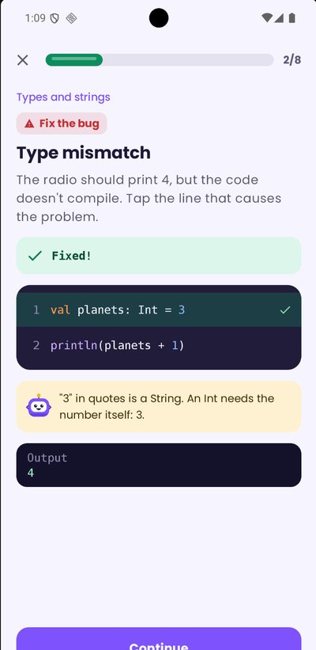
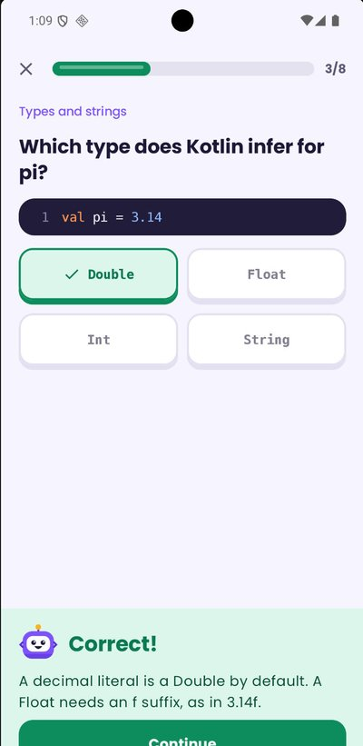
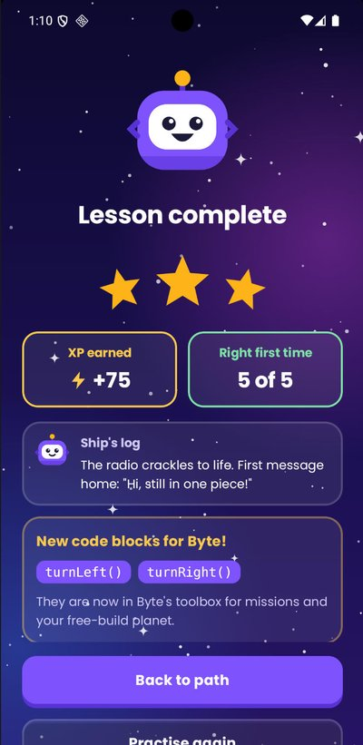
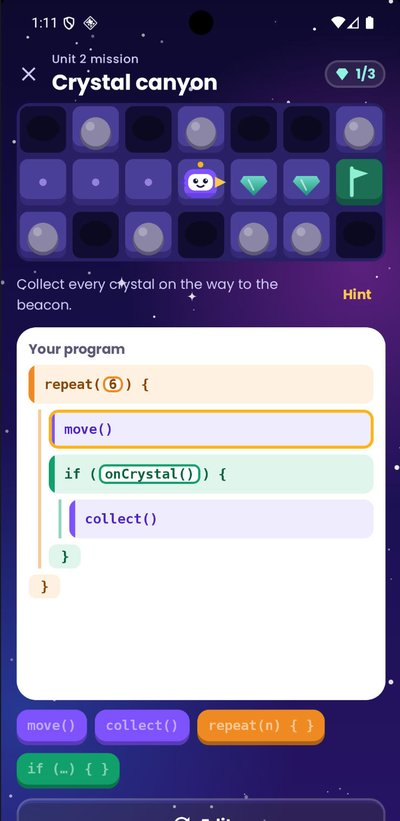
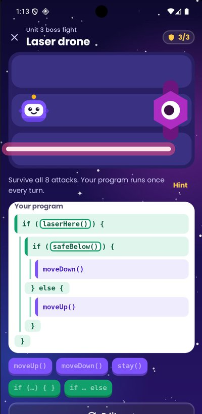
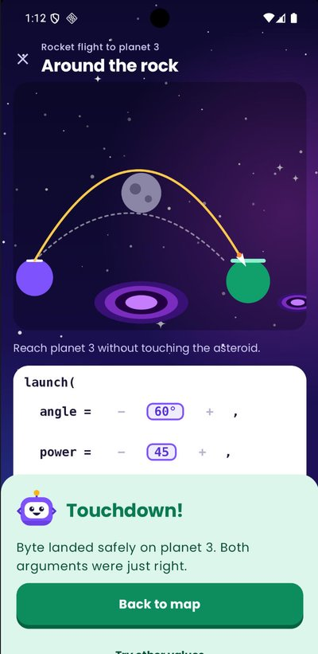
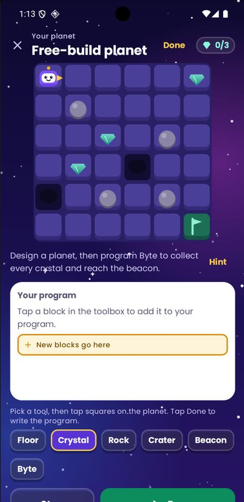

# CodeQuest

CodeQuest is an Android app that teaches Kotlin fundamentals to beginner programmers
(university students starting their first programming subject). Learners help Byte, a small
robot whose ship has crash-landed, by working along a space map of short lessons in the style
of Duolingo: they step through code, predict and change it, fix bugs and answer questions.
Each planet ends with a block-programming mission or a boss fight, rocket flights join the
planets, and a free-build planet lets learners program their own worlds with the code blocks
they have collected.

Built for **CP3406 Assessment 3: Education App** (James Cook University) by Bohong Hu.

## Screenshots

| Space map | Try it: predict, then change the code | Watch it: run code line by line |
|:---:|:---:|:---:|
|  |  |  |
| **Fix the bug** | **Practice question with feedback** | **Result: story and new code blocks** |
|  |  |  |
| **Planet mission (repeat and if)** | **Boss fight** | **Rocket flight** |
|  |  |  |
| **Free-build planet** | | |
|  | | |

## Core features

| Feature | What it does |
|---|---|
| Learning path | 4 units, 8 lessons and 40 questions on variables, types, conditionals, loops, functions, lambdas, collections and null safety. A lesson opens when the one before it is finished. |
| Interactive teaching cards | The first five lessons open with three cards before any question: **Watch it** (step through code line by line and see variables change), **Try it** (predict the result first, then change values in the code and watch a scene react) and **Fix the bug** (find the line that breaks the program). |
| Two question types | **Choice** questions (concepts, "what does this print?", fill the blank) and **ordering** questions, where the learner taps scrambled lines of code into a working order. |
| Mastery, not lives | A wrong answer is explained and the question returns at the end of the lesson. There are no hearts, timers or penalties; mistakes only affect the 1 to 3 star rating. |
| Bonus round | Downloads fresh computing questions from the Open Trivia DB API. The last downloaded round is cached, so it can be replayed offline. |
| Planet missions | Each unit ends with a mission instead of a test. Learners build a program from code blocks (`move()`, `repeat`, `if`/`else`, `while`) and watch Byte, the robot guide, run it on a grid planet, step by step, with the running block highlighted. |
| Boss fight | Unit 3 ends with the laser drone: three lanes, eight attacks, and a dodging program that runs automatically every turn. A program that only ever moves up fails, which is how learners discover `else` and nested conditions. |
| Code-block collection | Finishing a lesson for the first time hands Byte new code blocks (for example `repeat` and `while` after the loops lesson), shown on the result screen. Mission toolboxes show blocks that are not collected yet as locked. |
| Rocket flights | After each planet's mission, an optional flight to the next planet. The learner sets the two arguments of `launch(angle, power)` and watches the parabola; falling short or overshooting drops the rocket into a wormhole, and asteroids block some routes. |
| Free-build planet | A 6 x 6 planet the learner designs (rocks, craters, crystals, start and beacon), then programs with every block collected so far. The design is kept between visits. |
| Statistics | Lessons completed, XP, first-try accuracy, days practised, accuracy by topic and recent sessions. |
| Settings | Sound, bonus difficulty, theme, unlock-all-lessons, answer-history consent and "delete my progress". |

## Screens

| Screen | Purpose | Code |
|---|---|---|
| Onboarding | First launch only. Explains what is stored and asks one optional consent question. | `ui/onboarding` |
| Landing page (Learn) | Progress summary, "Continue" shortcut, bonus round and the lesson path. | `ui/home` |
| Activity (Lesson) | The quiz itself, with feedback after every answer. Also used for the bonus round. | `ui/lesson` |
| Result | Stars, XP and first-try score for the finished lesson. | `ui/result` |
| Mission | Block-programming challenge at the end of each unit, on a grid planet or in the boss arena. Also hosts the free-build planet (`mission/sandbox`). | `ui/mission` |
| Rocket flight | Set `launch(angle, power)` and fly to the next planet. | `ui/flight` |
| User statistics (Progress) | Headline numbers, accuracy by topic, recent sessions. | `ui/stats` |
| Settings | Preferences and privacy controls. | `ui/settings` |

## How it is built

### Architecture

The app follows the layered architecture recommended in the Android guide. Each layer only
knows about the one below it.

```
ui (Compose screens + ViewModels, one package per screen)
        |  StateFlow<UiState> up, events down
data/repository (interfaces + implementations: the single source of truth)
        |
data/local (Room)   data/remote (Retrofit)   DataStore
        
domain (pure Kotlin: models, QuizSession, Scoring, Progression) - used by every layer
```

- **Mission engine** (`domain/mission/`) is also pure Kotlin. `Program` is an immutable tree
  of blocks with editing operations; `Interpreter` runs it against a `MissionWorld`
  (`GridWorld` or `BossWorld`) and records a frame for every action and condition check, which
  the mission screen replays. A step limit stops endless `while` loops instead of freezing the app.
- **Flight physics** (`domain/flight/`) samples the parabola x = v·cos(θ)·t,
  y = v·sin(θ)·t − g·t²/2 and reports where the rocket lands or what it hits.
- **Domain layer** (`domain/`) has no Android imports. `QuizSession` is an immutable state
  machine for a lesson, `Scoring` turns a result into stars and XP, and `Progression` decides
  which lessons are open. This is where most unit tests are aimed.
- **Repositories** (`data/repository/`) are interfaces. ViewModels depend on the interface,
  and Hilt binds the real implementation (`di/RepositoryModule.kt`). Tests bind fakes.
- **ViewModels** expose one immutable `UiState` as a `StateFlow`, built with `combine` and
  `stateIn(WhileSubscribed)` so database work stops when the screen is not visible.
- **Screens** are split into a `Route` composable (gets the ViewModel) and a stateless
  `Screen` composable (takes state and lambdas), which is what the UI tests render.
- **Dependency injection** uses Hilt: `@HiltAndroidApp`, `@AndroidEntryPoint`,
  `@HiltViewModel`, a `@Provides` module for Room, Retrofit and DataStore, and a `@Binds`
  module for repositories.

### Navigation

`ui/navigation/CodeQuestNavigation.kt` uses Navigation Compose with a single `NavHost` and
**type-safe routes** (Navigation 2.8).

- Every screen is a `@Serializable` class or object in the sealed `Destination` interface
  (`ui/navigation/Routes.kt`). Arguments are constructor properties, so a missing or wrongly
  typed argument is a compile error: `navigate(Destination.Lesson(lessonId))`,
  `navigate(Destination.Result.from(sessionResult))`, and the result screen reads its
  arguments back with `entry.toRoute<Destination.Result>()`.
- ViewModels read their argument from `SavedStateHandle` under the property name
  (`lessonId`, `missionId`, `flightId`); `DestinationTest` checks the names stay in step.
- Three top-level tabs (Learn, Progress, Settings) with saved and restored tab state; the
  selected tab is found with `NavDestination.hasRoute(...)` on the destination hierarchy.
- **Adaptive**: a bottom navigation bar on phones and a navigation rail from 600 dp width
  (kept clear of the camera cutout). In landscape the mission and rocket-flight screens switch
  to two panes, with the board or sky on the left and the program or launch code on the right,
  and result sheets stay centred instead of stretching across the screen.
- Back stack control: onboarding is removed once finished, and a finished lesson is replaced
  by its result so Back never reopens a completed quiz.
- A type-safe deep link (`navDeepLink<Destination.Lesson>`), `codequest://lesson/{lessonId}`,
  opens a lesson directly. Try it with
  `adb shell am start -a android.intent.action.VIEW -d "codequest://lesson/basics-1"`.
- Leaving a lesson half-way asks for confirmation through `BackHandler`.

### Persistence (Room and DataStore)

`data/local/` defines six Room tables:

| Table | Content |
|---|---|
| `lessons`, `questions` | The course, copied from `SeedData` on first launch. Questions reference lessons with a cascading foreign key. Option lists are stored through a `TypeConverter`. |
| `lesson_progress` | Best stars and completion count per lesson (`@Upsert`). |
| `sessions` | One row per finished lesson or bonus round. |
| `attempts` | One row per answer. Written only if the learner opted in. |
| `trivia_cache` | The last downloaded bonus round for each difficulty. |
| `mission_progress` | Whether each mission is completed and how many runs it took. Added in database version 2 with a hand-written `Migration(1, 2)`, so updating the app keeps existing progress. |

Queries worth a look: a `LEFT JOIN` that returns lessons with progress as a `Flow`,
`GROUP BY` topic accuracy, a distinct-calendar-day count with `strftime`, and `@Transaction`
methods that save a session atomically and keep the best star rating.

Preferences (theme, sound, difficulty, consent) and the free-build planet's design are stored
with Preferences DataStore. Collected code blocks need no storage of their own: they are worked
out from completed lessons (`BlockCollection`), so they can never disagree with progress.
Completed rocket flights reuse the `mission_progress` table.

### Networking

`data/remote/TriviaApi.kt` is a Retrofit interface for
[Open Trivia DB](https://opentdb.com) (category 18, "Science: Computers"), parsed with
kotlinx.serialization. `NetworkTriviaRepository` is network-first with a Room fallback: a
successful download replaces the cache, and any failure (offline, timeout, rate limit) falls
back to the cached round. The API needs no key and the request contains no user data.

### Libraries

Kotlin 2.0, Jetpack Compose with Material 3, Navigation Compose, Hilt, Room, DataStore,
Retrofit with OkHttp, kotlinx.serialization and coroutines/Flow. Versions are in
`gradle/libs.versions.toml`.

## Ethical and professional design

The app applies the issues researched in Assessment 2 (data privacy, dark patterns and the
ACS Codes).

| Decision | Where to see it |
|---|---|
| **Privacy by default.** No answer history is kept until the learner opts in. | `UserSettings` defaults, `LessonViewModel.finish` |
| **Equal-weight consent.** Accept and Decline use the same button, size and weight, and nothing is preselected. A UI test asserts the two buttons are the same size. | `OnboardingScreen`, `OnboardingScreenTest` |
| **Declining never blocks learning.** Every lesson works without the optional history. | `StatsScreen` (explains what is unavailable and why) |
| **Withdrawing consent deletes the data** collected under it. | `SettingsViewModel.setDetailedHistory` |
| **Data minimisation.** No account, no ads, no analytics SDK. The only permission is `INTERNET`. | `AndroidManifest.xml` |
| **Data stays on the device.** Auto Backup and device transfer are switched off. | `data_extraction_rules.xml`, `backup_rules.xml` |
| **No addictive design.** No streaks to lose, lives, countdowns or reminder notifications. "Days practised" only ever goes up. | `ResultScreen`, `ProgressDao.observeDaysPractised` |
| **User autonomy.** The learner can unlock all lessons, change consent and delete all progress at any time. | `SettingsScreen` |
| **Accessibility.** TalkBack labels and headings, feedback announced as a live region, results shown with icons as well as colour, 48 dp touch targets, light and dark themes. | `ui/` |
| **Transparency.** The privacy summary and the data source and licence are shown in Settings. | `SettingsScreen` |

### Not implemented

Two ideas from the Assessment 2 presentation were left out of this version:

- **Keystore encryption of progress.** The app stores no personal identifiers, the database
  is in app-private storage and backup is disabled, so encryption was judged a low priority.
- **Attaching an image with the photo picker.** The final feature set has no need for
  learner images, so the most private option was to request no media access at all.

## Testing

Local JVM tests (`app/src/test`), run with `./gradlew test`:

| Test class | Covers |
|---|---|
| `QuizSessionTest`, `ScoringTest`, `ProgressionTest` | Quiz rules, stars and XP, lesson unlocking |
| `TriviaQuestionsTest`, `SeedDataTest` | API text decoding and the integrity of all 40 built-in questions |
| `TriviaRepositoryTest` | Network-first loading, cache fallback, JSON parsing |
| `ProgramTest`, `MissionEngineTest` | Building and editing block programs; running them on grids and in the boss arena |
| `MissionCatalogTest` | Every mission is solvable with its own toolbox, and common wrong programs fail |
| `MissionViewModelTest` | Tap-to-build editing, replay, stepping, saving the result, locked blocks and the free-build planet |
| `BlockCollectionTest` | Every mission can be built from blocks collected in the lessons before it |
| `SandboxMapTest` | Designing the free-build planet: one start and one beacon, saving and loading |
| `DestinationTest` | Navigation arguments: route property names match the `SavedStateHandle` keys, and a session result maps onto the result route |
| `FlightTest`, `FlightViewModelTest` | Rocket physics against the textbook range formula, asteroid hits, every flight being landable, and the launch screen state |
| `LearnCatalogTest` | Every teaching card's simulation, prediction and goal matches what the Kotlin code really does |
| `KotlinTokenizerTest` | Syntax colouring of code snippets |
| `LessonViewModelTest`, `HomeViewModelTest`, `SettingsViewModelTest`, `StatsViewModelTest` | ViewModel state and the consent logic, using fake repositories |

Instrumented tests (`app/src/androidTest`), run with `./gradlew connectedAndroidTest` on an
emulator or device:

| Test class | Covers |
|---|---|
| `ProgressDaoTest` | Real Room queries against an in-memory database |
| `OnboardingScreenTest`, `LessonScreenTest` | Compose GUI tests of the consent and activity screens |
| `FlightScreenTest` | Compose GUI tests of the rocket flight: dials, Launch, and the landed and missed result panels |

## Running the app

1. Open the project folder in Android Studio and let Gradle sync.
2. Run the `app` configuration on an emulator or device with Android 8.0 (API 26) or newer.
3. The bonus round needs an internet connection. Everything else works offline.

## Credits

Bonus-round questions come from [Open Trivia DB](https://opentdb.com), licensed
CC BY-SA 4.0. The Kotlin course content was written for this project.

Fonts bundled in `app/src/main/res/font`:

- [Poppins](https://github.com/itfoundry/Poppins), SIL Open Font License 1.1.
- [DejaVu Sans Mono](https://dejavu-fonts.github.io), Bitstream Vera licence with DejaVu changes in the public domain.

Byte the robot, the planets and the star field are drawn in code (`ui/components/Space.kt`);
the app ships no image assets.
